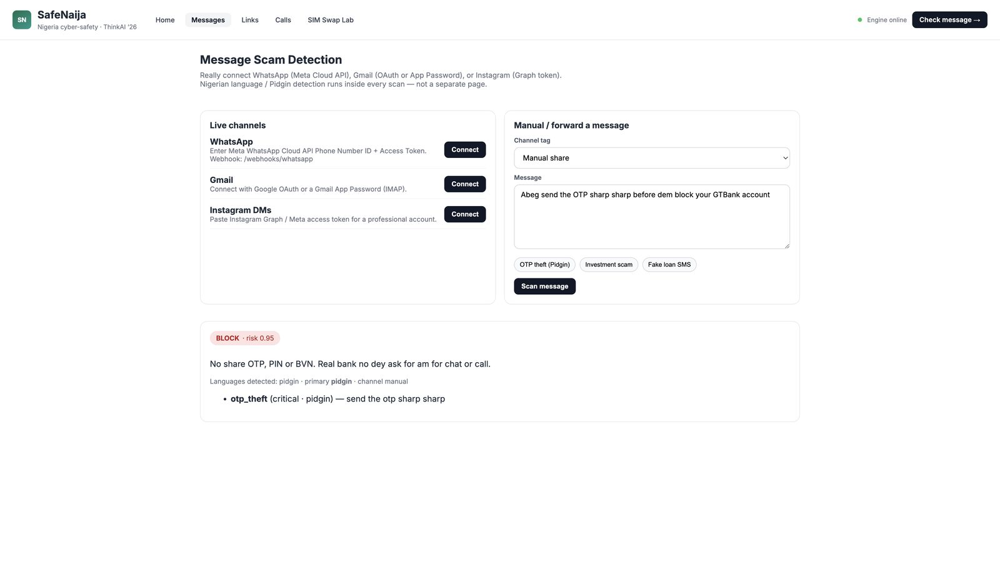
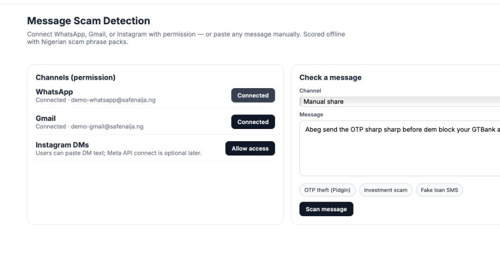
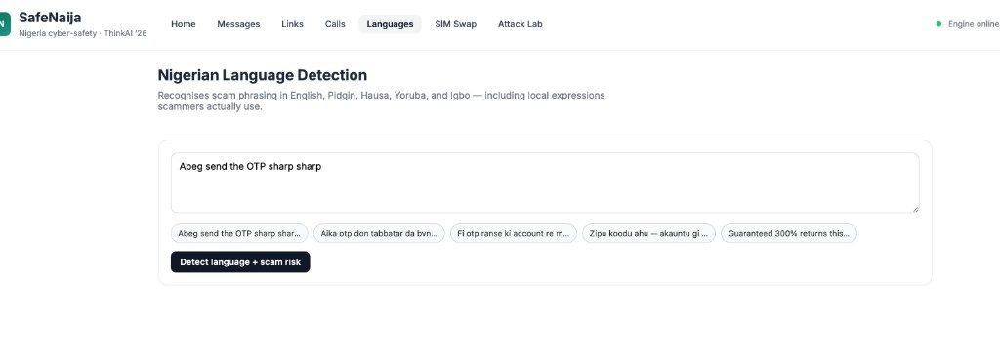
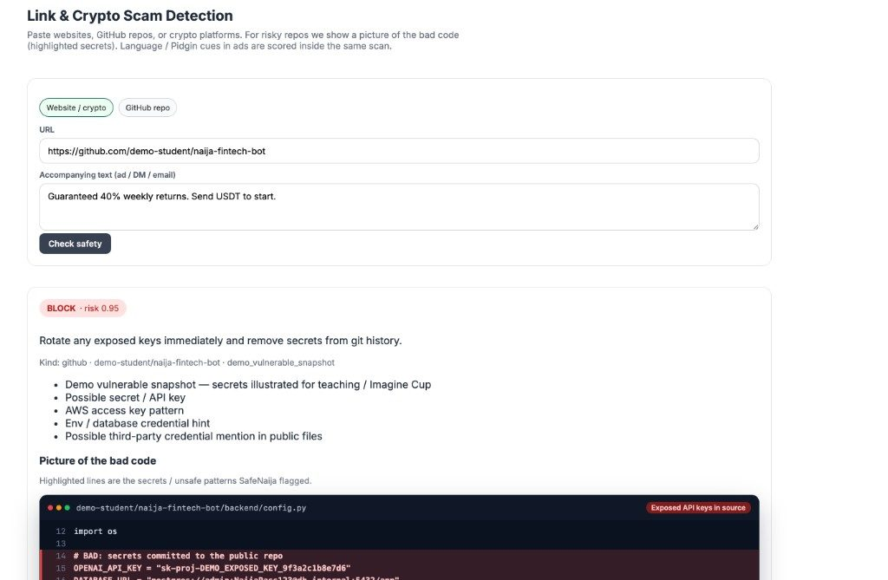

# SafeNajia (SafeNaija)

**ThinkAI ’26 · Nigeria · Cybersecurity**  
AI trust layer for WhatsApp, Gmail, Instagram, links, GitHub, and phone numbers — decisions as **SAFE / CAREFUL / DANGER** in English, Pidgin, and Nigerian languages.

> Protect students and WhatsApp SMBs on the channels they already use, before OTP or money leaves the phone.

## Demo video

Watch the prototype walkthrough (Google Drive):

**[SafeNajia demo video folder](https://drive.google.com/drive/folders/1D3imdRD2F6wBZ5q_iGs_-SKUMQxebVHh?usp=sharing)**

```
https://drive.google.com/drive/folders/1D3imdRD2F6wBZ5q_iGs_-SKUMQxebVHh?usp=sharing
```

## Project links (also on the pitch deck)

| Item | Link |
|---|---|
| **Demo video** | https://drive.google.com/drive/folders/1D3imdRD2F6wBZ5q_iGs_-SKUMQxebVHh?usp=sharing |
| **GitHub** | https://github.com/Shreeya1-pixel/SafeNajia.git |

## News sources (show these)

Full clickable list: **[NEWS_SOURCES.md](NEWS_SOURCES.md)** · also on **slide 17** of the pitch deck (with Demo + GitHub).

| Story / number | Open |
|---|---|
| FIJ — WhatsApp bank-care theft ₦102k | [fij.ng](https://fij.ng/article/alat-by-wema-fraudster-steals-plateau-womans-n102000/) |
| Vanguard — SIM-swap arrests | [vanguardngr.com](https://www.vanguardngr.com/2025/01/police-nab-syndicate-using-sim-swap-to-defraud-bank-customers/) |
| Punch — ₦25.85bn payment fraud losses | [punchng.com](https://punchng.com/digital-payment-fraud-losses-drop-51-to-n25-85bn/) |
| TechCabal — CBEX collapse | [techcabal.com](https://techcabal.com/2025/04/15/cbex-ponzi-collapse-nigeria/) |
| Premium Times — CBN fraud-message alert | [premiumtimesng.com](https://www.premiumtimesng.com/business/business-news/873799-cbn-alerts-public-to-fraudulent-messages-cybersecurity-hack-attempts.html) |
| NCC-CSIRT — free data/airtime phishing | [csirt.ncc.gov.ng](https://csirt.ncc.gov.ng/index.php/resources/security-advisories/431-fraudulent-free-data-and-airtime-phishing-campaign-hosted-on-ibaidad-com) |
| SEC Nigeria — verify platforms | [sec.gov.ng](https://sec.gov.ng) |

## Prototype screenshots

### Messages — Pidgin OTP scam → BLOCK



### Live channels — WhatsApp / Gmail connect



### Nigerian language packs (EN · Pidgin · Hausa · Yoruba · Igbo)



### GitHub Risk Passport — secrets + bad-code picture



---

## Features

### Product capabilities

| # | Feature | What it does |
|---|---------|--------------|
| 1 | **Message scam detection** | Scan WhatsApp / Gmail / Instagram / pasted text for OTP theft, investment scams, fake loans, bank impersonation |
| 2 | **Live channel connect** | Real WhatsApp (Meta Cloud API), Gmail (OAuth or App Password IMAP), Instagram (Graph token) |
| 3 | **Chat Demo** | NABD-style WhatsApp / Instagram phone UI with Hausa, Yoruba, Igbo, Pidgin, and English scam scenarios |
| 4 | **Link & crypto scan** | Live website visit, APK / loan-app cues, crypto “guaranteed returns” signals |
| 5 | **SEC Nigeria cues** | Demo registry pack + advice to verify on [sec.gov.ng](https://sec.gov.ng) |
| 6 | **GitHub Risk Passport** | Public-repo secret patterns + **picture of the bad code** (highlighted keys) |
| 7 | **Fraud call check** | Number-only risk (reported lists / patterns) — **no call recording** |
| 8 | **Nigerian language packs** | English · Pidgin · Hausa · Yoruba · Igbo phrases embedded in every scan |
| 9 | **SIM Swap Lab** | Self-declared exposure questionnaire + Google / DuckDuckGo OSINT terminal |
| 10 | **Alert simulation** | SIM-swap / bank-account alert timelines for demos |
| 11 | **Attack Lab** | Dummy phishing / secret-leak / offline scenarios |
| 12 | **Offline phrase packs** | Basic OTP / BVN / NIN detection without an external LLM |
| 13 | **Trust Chain** | WHO → WHAT → WHERE → WHY → HOW → RESULT explainability |
| 14 | **Case Library** | Sourced Nigerian incidents (NCC-CSIRT / CBN / SEC / press) |
| 15 | **Decision badges** | SAFE / CAREFUL / DANGER + risk score + plain next-step advice |

### API surface (`/nigeria/*`)

- `POST /nigeria/scan/message` — message / inbox text  
- `POST /nigeria/scan/link` — website / crypto URL (+ accompanying ad text)  
- `POST /nigeria/scan/github` — GitHub repo secrets + code frames  
- `POST /nigeria/phone/check` — fraud-call number check  
- `POST /nigeria/sim-swap/risk` · `/osint` · `/alerts/simulate`  
- `POST /nigeria/attacks/simulate`  
- `GET /nigeria/offline` · `/features` · `/health` · `/channels`  
- Channel connect / inbox scan under `/nigeria/channels/...`

Legacy SafeO routes (`/v1/scan`, website scanner, WhatsApp webhook) remain available.

### UI routes

| Path | Page |
|------|------|
| `/` | Home |
| `/messages` | Message scan + live channel connect |
| `/chat-demo` | WhatsApp / Instagram phone demo |
| `/links` | Link / crypto / GitHub |
| `/calls` | Fraud call check |
| `/sim-swap` | SIM Swap Lab (+ attack sims) |
| `/cases` | Case Library |

---

## Market strategy

### Who are our customers?

| Customer | Pain today | How they buy | What they need |
|----------|------------|--------------|----------------|
| **University students** | OTP / loan-app / GitHub secret scams | Free campus plan | Pidgin chat check + GitHub passport |
| **WhatsApp SMBs** | Fake buyer / payment proof / phishing links | Low monthly SaaS (₦) | Fast SAFE / CAREFUL / DANGER on chat |
| **Campus clubs / NGOs** | Awareness with no SOC budget | Pilot / grant pack | Demo lab + Case Library |
| **Banks / telcos (later)** | Consumer education layer | B2B API / white-label | NDPA-safe local language packs |

**Beachhead:** students + WhatsApp SMBs (no security team).  
**Upsell path:** campus licence → SMB SaaS → bank / telco API.

### Go-to-market (how we win)

1. **Seed** — Campus ambassadors; Chat Demo + GitHub passport at 2–3 universities  
2. **Prove** — Measure blocked OTP attempts & false alarms; grow Case Library  
3. **Monetise** — SMB WhatsApp plan (starter ₦2–5k / month) + inbox scan add-on  
4. **Scale** — SEC / CBN advice hooks; white-label for fintech; NCC-CSIRT report path  

**Funnel:** Awareness (campus demo) → Activation (Chat Demo BLOCK) → Retention (weekly scam digest) → Revenue (SMB SaaS / API).

### Market context

- Nigeria cybersecurity market ≈ **USD 230m (2025)** → **USD 415m (2031)** (~10% CAGR)  
- Gap: affordable **consumer / SMB trust checks on WhatsApp** — not another enterprise SIEM  
- Banks catch cards; victims still hand over OTPs on chat (especially Pidgin / local languages)

### Why not “another Genie”?

Norton Genie standalone was English-first, paste-only, and struggled to monetise / localise.  
SafeNajia is **chat-native**, **Nigeria-language first**, **GitHub-aware**, and priced for campus → SMB → API.

### Future steps

| Horizon | Focus |
|---------|--------|
| **Now (MVP)** | Chat Demo, Gmail connect, GitHub frames, EN/Pidgin + NG language packs |
| **+90 days** | Campus pilot 2–3 unis · WhatsApp Cloud production · ambassador playbook |
| **+6 months** | SMB WhatsApp SaaS · live SEC hook · expand Hausa/Yoruba/Igbo · offline mobile pack |
| **+12 months** | Bank/telco API talks · white-label packs · NCC-CSIRT assist · West Africa localisation |

**Success metrics:** OTP BLOCK accuracy · false BLOCK rate · campus WAU · SMB trial→paid · time-to-advice &lt; 2s offline.

---

## Quick start (localhost)

### Backend (API `:8001`)

```bash
cd backend
python3 -m venv .venv && source .venv/bin/activate
pip install -r requirements.txt
export PYTHONPATH="$(pwd)"
uvicorn safeo_backend.main:app --host 127.0.0.1 --port 8001 --reload
```

- Docs: http://127.0.0.1:8001/docs  
- Nigeria health: http://127.0.0.1:8001/nigeria/health  

### Frontend (UI `:5174`)

```bash
cd frontend/website
npm install
npm run dev -- --host 127.0.0.1 --port 5174
```

Open http://127.0.0.1:5174/chat-demo

### 5-minute demo path

1. **Chat Demo** → Hausa / Pidgin OTP → DANGER / BLOCK  
2. **Messages** → connect Gmail (App Password) or paste OTP sample → BLOCK  
3. **Links** → GitHub demo repo → BLOCK + bad-code picture  
4. **SIM Swap** → OSINT terminal + alert simulate  
5. **Cases** → sourced Nigerian incidents  

---

## Privacy & compliance posture

- Default message scoring uses **local phrase packs** (not sent to an external LLM)  
- Fraud-call checks compare **numbers only** — no listening / recording  
- Inbox connect requires **user permission** (NDPA-minded)  
- SEC pack is a **demo subset** — always verify live on SEC Nigeria  
- We **advise**; we do not vigilante — report paths: EFCC / police / NCC-CSIRT  

---

## Project layout

```
SafeNajia/
├── backend/safeo_backend/
│   ├── nigeria/           # NG engine + phrase / SEC / number packs
│   ├── routes/nigeria.py  # /nigeria/* API
│   └── …                  # inherited SafeO stack
├── frontend/website/      # SafeNaija UI (Vite + React)
├── outputs/               # Pitch PPTX builders + diagrams
└── README.md
```

## Pitch materials

- `outputs/build_safenaija_pitch_full.py` — rebuild ThinkAI deck  
- `outputs/SafeNaija_diagrams.md` — Mermaid flowcharts (engine, GTM, roadmap)  

## Origin

Forked from Tatweer / SafeO (Band of Agents) WhatsApp + website scanner stack.  
Restoried for **Nigeria ThinkAI ’26 / Imagine Cup** as **SafeNajia / SafeNaija**.

## License

See [LICENSE](LICENSE).
