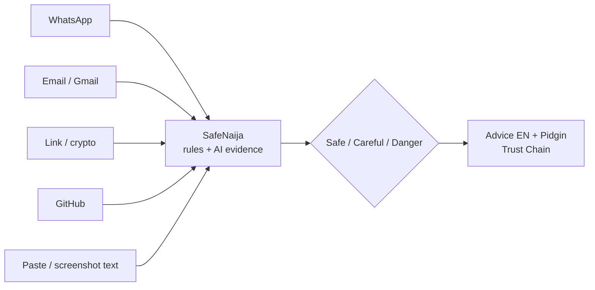
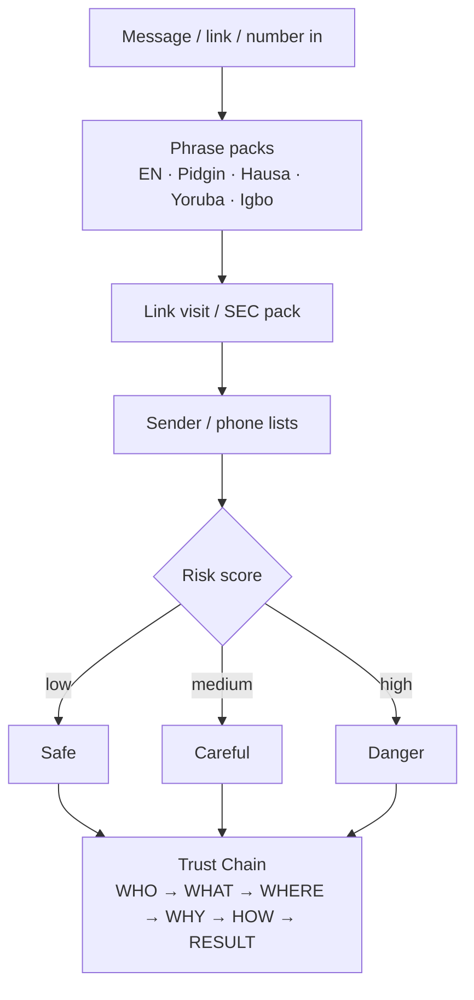
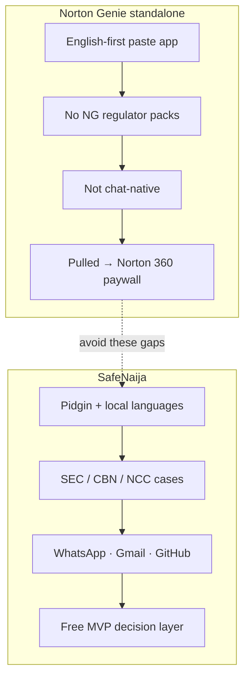
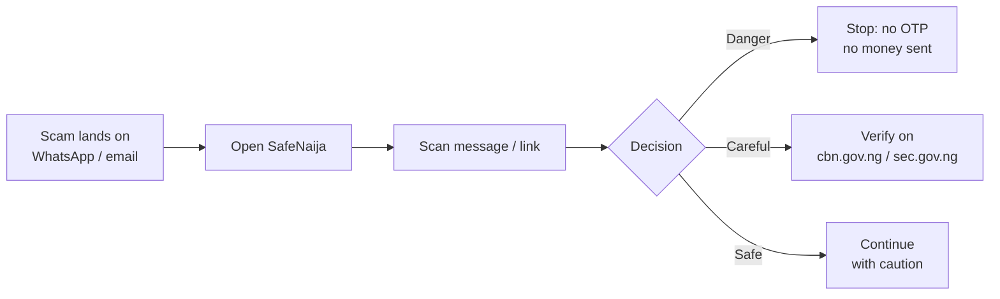
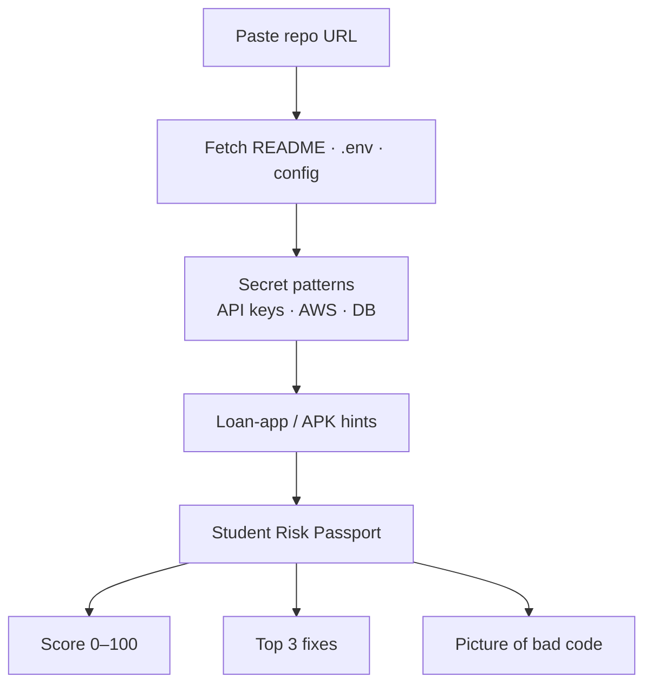
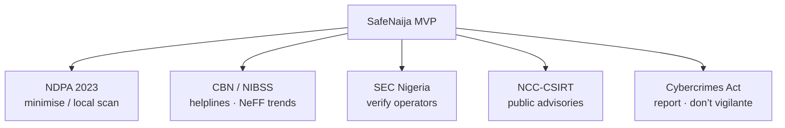
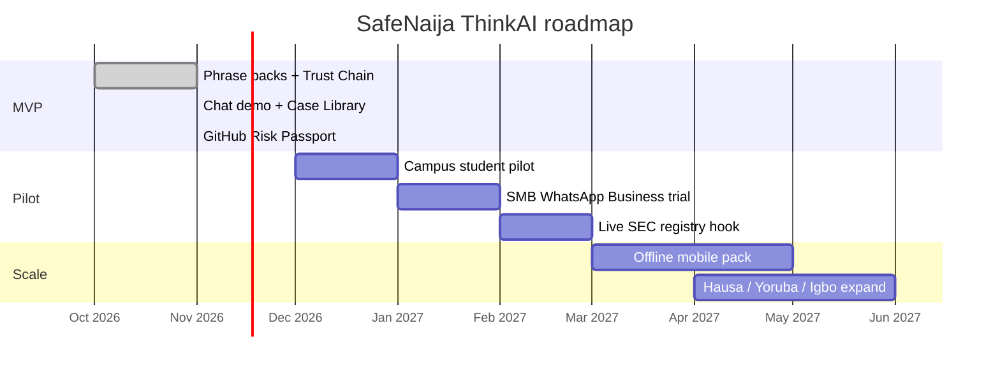

# SafeNaija — ThinkAI ’26 Twist · Mermaid diagrams

Open in [mermaid.live](https://mermaid.live), GitHub, or Notion. Short labels for slides.

Country: **Nigeria** · Domain: **Cybersecurity** · Failed product contrast: **Norton Genie standalone**

---

## 1. System architecture

WhatsApp / email / GitHub / paste → SafeNaija engine → Safe / Careful / Danger

---

## 2. Decision flow

---

## 3. Why Genie standalone failed vs SafeNaija

---

## 4. User journey (victim → outcome)

---

## 5. GitHub Student Risk Passport

---

## 6. Nigeria feasibility map

---

## 7. Build roadmap

---

## 8. Market & loss snapshot (cite on slides)

| Figure | Meaning | Source |
|---|---|---|
| ₦25.85bn | Digital-payment fraud losses 2025 | NIBSS / Punch (NeFF 2026) |
| 67,518 | Reported fraud cases 2025 | NIBSS |
| ~₦250bn | Yearly cybercrime loss estimate | NITDA / Guardian Aug 2025 |
| USD 230m → 254m | NG cybersecurity market 2025→2026 | Mordor Intelligence |
| ₦102,000 | WhatsApp bank-impersonation loss | FIJ, 20 Feb 2025 |
| CBEX | Unregistered investment collapse | TechCabal Apr 2025 · SEC |

---

## Sources (speaker notes)

- Punch — fraud losses drop 51% to ₦25.85bn (2026 NeFF data)
- The Cable / ThisDay — CBN & NIBSS on SIM-swap / social engineering
- Guardian — NITDA ₦250bn cybercrime estimate (26 Aug 2025)
- FIJ — ALAT/Wema WhatsApp theft ₦102k (20 Feb 2025)
- Vanguard / NAN — Katsina SIM-swap arrests (16 Jan 2025)
- TechCabal — CBEX collapse (15 Apr 2025)
- Mordor — Nigeria cybersecurity market outlook
- Norton / AppGoblin / Gen Digital — Genie standalone removed; folded into Norton 360 / ChatGPT / Claude
