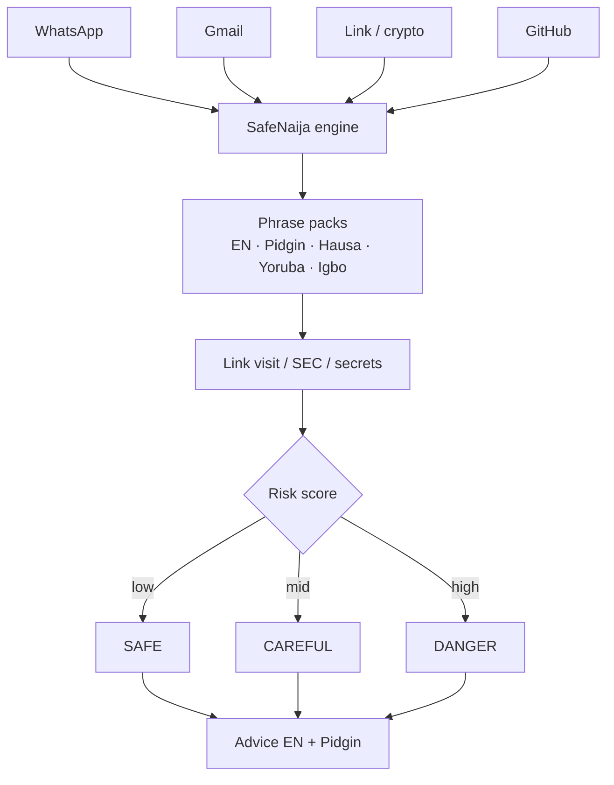
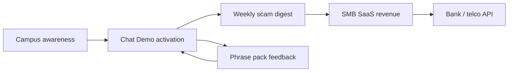
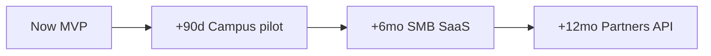

# SafeNaija — flowcharts (ThinkAI ’26)

Open in [mermaid.live](https://mermaid.live).

## 1. Scan engine

## 2. Go-to-market / customers

## 3. Future steps

## 4. Customer segments (table summary)

| Customer | Pain | Buy motion | Need |
|---|---|---|---|
| University students | OTP / loan / GitHub secrets | Free campus | Pidgin chat + GitHub passport |
| WhatsApp SMBs | Fake payment / phishing | Low monthly SaaS | Fast Safe/Careful/Danger |
| Clubs / NGOs | No SOC budget | Pilot / grant | Demo lab + cases |
| Banks / telcos (later) | Consumer education | B2B API | NDPA-safe language packs |
