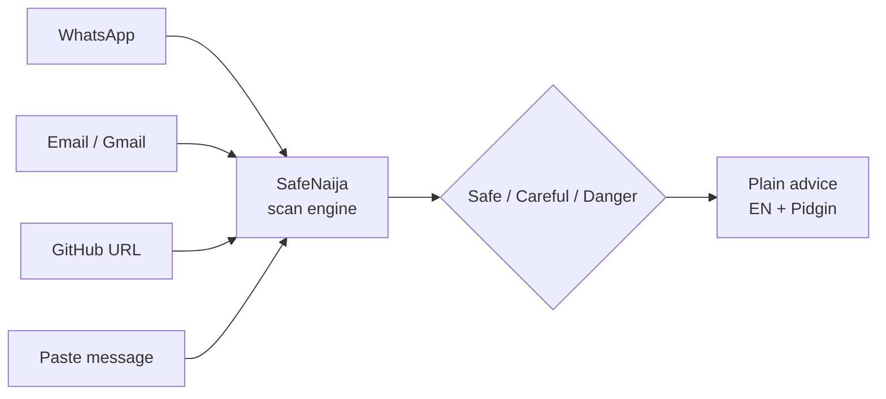
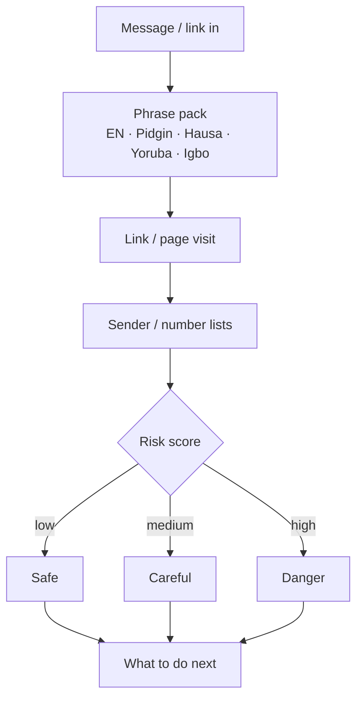
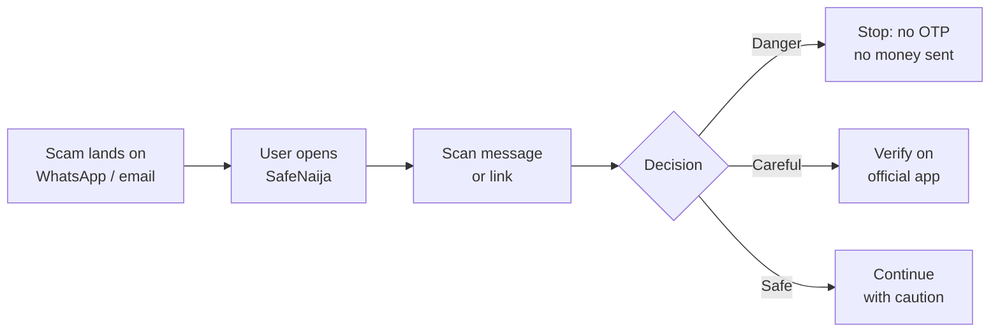
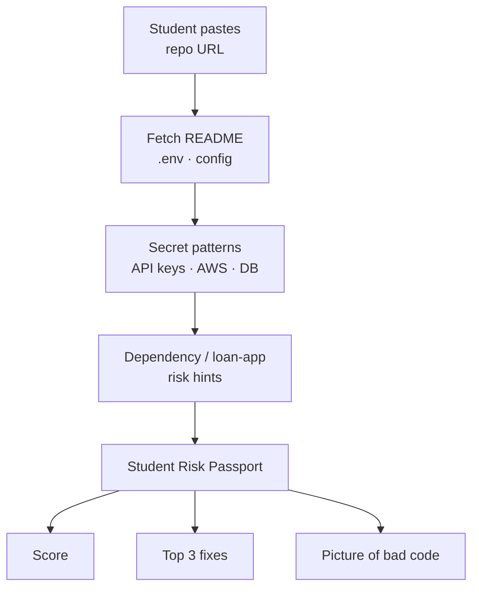
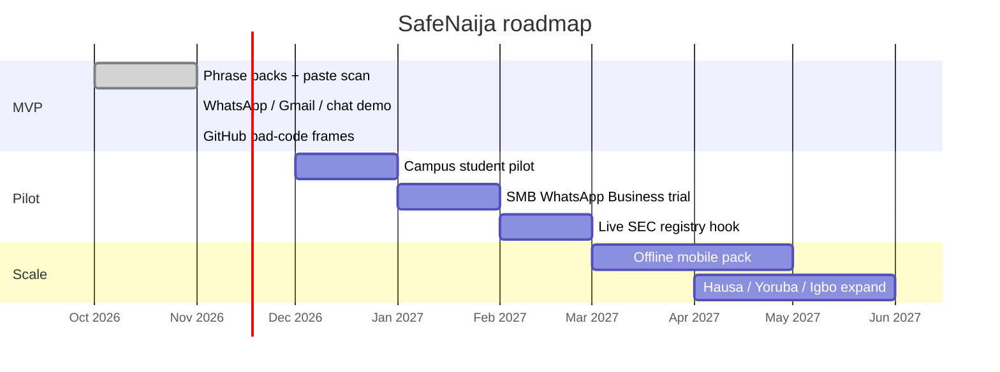

# SafeNaija — Mermaid diagrams

Open in [mermaid.live](https://mermaid.live), GitHub, or Notion. Labels stay short for slides.

---

## 1. System architecture

WhatsApp / email / GitHub / paste → scan engine → decision

---

## 2. Decision flow

Message in → checks → Safe / Careful / Danger → advice

---

## 3. User journey

Victim receives scam → SafeNaija → outcome

---

## 4. GitHub scan flow

Repo URL → secret checks → Risk Passport

---

## 5. Build roadmap

